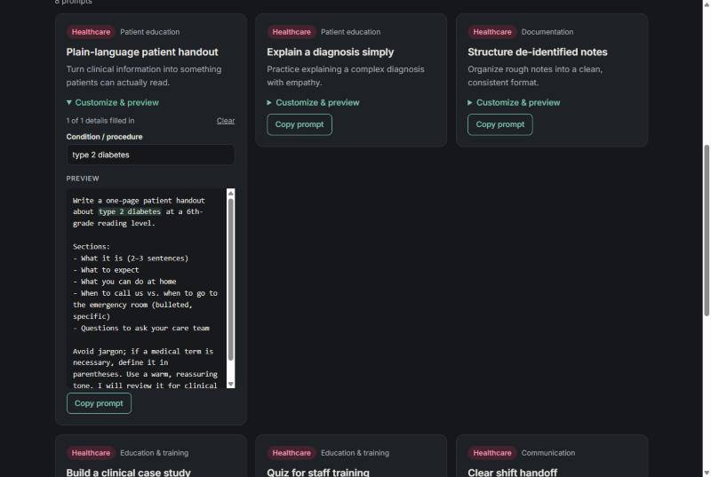

# AI Prompt Library for Work, School & Everyday Life

[](https://github.com/sleepeq-null/AI-prompts-library/actions/workflows/validate.yml)
[](https://github.com/sleepeq-null/AI-prompts-library/actions/workflows/codeql.yml)
[](https://github.com/sleepeq-null/AI-prompts-library/actions/workflows/pages/pages-build-deployment)

[](https://github.com/sleepeq-null/AI-prompts-library/issues/new?template=suggest-prompt.yml)

**Live site: [sleepeq-null.github.io/AI-prompts-library](https://sleepeq-null.github.io/AI-prompts-library/)**

> 💡 **Have a prompt that works well?** [Suggest it here](https://github.com/sleepeq-null/AI-prompts-library/issues/new?template=suggest-prompt.yml). No coding needed. Questions or ideas? Join the [Discussions](https://github.com/sleepeq-null/AI-prompts-library/discussions).

A searchable library of 40 ready-to-use AI prompts for **educators, healthcare teams, accountants, Microsoft 365 Copilot users, students and families**, with an interactive builder that turns a prompt template into a finished prompt you can copy and paste into any AI assistant.


## What's inside

| Area | Example prompts |
|---|---|
| **Education** | Lesson plans, differentiated activities, rubrics, quizzes, writing feedback, family emails |
| **Healthcare** | Plain-language patient handouts, SOAP and SBAR formatting, teaching cases, research summaries |
| **Accounting** | Budget vs. actual commentary, month-end close checklists, reconciliation troubleshooting, Excel formulas, technical memos |
| **Microsoft 365 Copilot** | Outlook thread summaries, Teams meeting recaps, Word drafts from files, Excel insights, PowerPoint decks from documents |
| **Everyday life** | Homework tutor that gives hints instead of answers, study plans, help for parents, meal plans, budgets, decoding confusing letters, resume bullets |

## Features

- **Interactive prompt builder.** Each prompt's `[PLACEHOLDERS]` become form fields automatically. As you type, a live preview highlights what you've filled in and what's still blank, and **Copy prompt** copies the finished text.
- **Open in Claude, free.** One click opens the finished prompt at claude.ai in a new tab, using the visitor's own Claude account (the free plan works). The site needs no API key and has no running costs. The prompt is also copied, so it can be pasted if the pre-fill doesn't come through (for example, after signing in). Very long prompts, like ones with a pasted essay, are copied instead of pre-filled, to stay under URL-length limits.
- **Filter and search.** Switch between five areas, narrow by topic, or search across titles and prompt text.
- **Privacy built in.** A visible notice and paste-field hints remind users never to include student, patient or client identifiers. Healthcare and accounting prompts ask for de-identified data (no account numbers) and tell the AI not to invent findings or figures.
- **Accessible and responsive.** Labelled form fields, keyboard-friendly controls, automatic dark mode, a layout that works at phone width, and a background video that holds still for visitors who have "reduce motion" turned on.
- **No build step.** Plain HTML, CSS and JavaScript, so it's fast, easy to host, and easy for non-developers to edit.



## How it works

| File | Role |
|---|---|
| `prompts.js` | The content: an array of prompt objects (`sector`, `category`, `title`, `use`, `prompt`). Non-developers only need to edit this file. |
| `app.js` | Rendering, filtering, search, the prompt builder and copy-to-clipboard |
| `styles.css` | Design tokens as CSS custom properties, with light and dark themes |
| `index.html` | Page structure and the card `<template>` |

**The builder** finds every `[BRACKETED]` placeholder in a prompt with a regular expression and turns each unique one into a form field:

- The bracket text becomes the label. Anything after `, e.g.` becomes placeholder text: `[LENGTH, e.g. 45-minute]` gives a **Length** field with the hint *e.g. 45-minute*.
- Placeholders starting with `PASTE` get a multi-line text area.
- A placeholder used more than once, like `[GRADE LEVEL]`, is one field that fills every occurrence.
- Typed values are kept per prompt, so they survive switching filters or searching.

Adding a new prompt with new placeholders needs no code changes: the form generates itself. Markers the AI itself should write, like `(ASSUMPTION)`, use parentheses so they don't become form fields.

## Design decisions

- **Static site over a framework.** The content is small and changes rarely, so plain HTML, CSS and JavaScript keeps the site fast, dependency-free and free to host on GitHub Pages.
- **Prompts in a `.js` file, not `.json`.** A `<script>` tag loads it, so the page also works opened straight from disk, where browsers block `fetch()` of local files.
- **Safe rendering.** Prompt text and user input are HTML-escaped before being highlighted in the preview, so pasted content can't inject markup.
- **Cache-busting.** GitHub Pages lets browsers cache files for about 10 minutes, which once caused new HTML to load with an old stylesheet. Asset links carry a version query (`styles.css?v=8`) that changes with each release.
- **"Open in Claude" instead of an embedded chatbot (for now).** Linking to claude.ai lets visitors run prompts for free on their own accounts, with no API key to protect, no per-use cost and no abuse risk for the site. The trade-off is that the prompt travels in the link (so it can show up in browser history), which is one more reason the site tells people never to include personal information. An on-page "Try it" button through a secured AI gateway is planned as v2.0.
- **Homework prompts that teach, not cheat.** The homework prompts tell the AI to ask guiding questions, give hints, and point to where a mistake is rather than handing over answers. Students get help learning, which is also what teachers and parents want.
- **Lightweight media.** The 12-second header video is the 720p version (3.6 MB), muted, looping and inline, under a gradient that keeps the text readable.

## Prompt-writing approach

Each prompt follows the same structure, which makes AI output more reliable:

1. **Role.** "You are an experienced 7th-grade science teacher…"
2. **Task and context.** What to make, for whom, and what the learners or patients already know.
3. **Format.** Sections, word limits, reading level.
4. **Guardrails.** "Only use information in the notes", "Do not rewrite the essay for them", "If a reason for a variance isn't clear, list it as a question instead of guessing".

Microsoft 365 Copilot prompts are written for the app they run in. They refer to "this email thread" or "this table" and use Copilot's `/` file picker, because Copilot already has the content open.

## Adding a prompt

Add an object to `prompts.js`:

```js
{
  sector: "education",          // or "healthcare", "accounting", "m365", "life"
  category: "Assessment",       // new categories become filter chips automatically
  title: "Short card title",
  use: "One line on when to use it.",
  prompt: `The full prompt text.
Use [BRACKETS] for anything the reader fills in, e.g. [TOPIC, e.g. fractions].`
},
```

Then change `?v=8` to the next number in `index.html` so returning visitors get the update.

## Automated checks

Every push and pull request runs **[Validate prompts](.github/workflows/validate.yml)** on GitHub Actions. The script ([`scripts/validate-prompts.mjs`](scripts/validate-prompts.mjs)) loads `prompts.js` the same way the browser does and fails the build if it finds:

- missing or empty fields, or duplicate titles
- unbalanced, nested or empty `[brackets]` that would break the builder
- a sector with no matching tab in `index.html`
- text that looks like real personal data (emails, SSN-style or card-length numbers)
- mismatched `?v=` cache-busting versions

It also warns about prompts with no placeholders, and bracketed markers like `[ASSUMPTION]` that should be in parentheses.

## Security

The project follows secure software development practices, with security checks built into every stage:

| Stage | Control |
|---|---|
| **Write** | Secret scanning with push protection blocks commits containing credentials |
| **Review** | CODEOWNERS routes every change, especially CI/CD and scripts, to the maintainer |
| **Build** | CodeQL static analysis (`security-extended`) on the JavaScript and the Actions workflows, plus the prompt validator's personal-data screen |
| **Supply chain** | Every GitHub Action is pinned to a full commit SHA and kept current by Dependabot; Dependabot alerts and security updates are on |
| **Pipeline** | Least-privilege workflow permissions, no stored checkout credentials, and `main` protected by required status checks |
| **Run** | A strict Content Security Policy (self-hosted scripts only, no inline code), HTML-escaping of all prompt text and user input, and no backend, cookies or tracking |

Found a vulnerability? Please report it privately. See [SECURITY.md](SECURITY.md).

## Contributing

Suggestions are welcome. You can [suggest a prompt](https://github.com/sleepeq-null/AI-prompts-library/issues/new?template=suggest-prompt.yml) through a guided form, [report a problem](https://github.com/sleepeq-null/AI-prompts-library/issues/new?template=report-problem.yml), or open a pull request. See [CONTRIBUTING.md](CONTRIBUTING.md).

## Run locally

Open `index.html` in a browser, or serve the folder with any static server. To run the checks:

```bash
node scripts/validate-prompts.mjs
```

## Credits

Header video: [Time Lapse View of Brooklyn Bridge at Night](https://www.pexels.com/video/time-lapse-view-of-brooklyn-bridge-at-night-5606315/) by Sarowar Hussain, used under the [Pexels License](https://www.pexels.com/license/).
